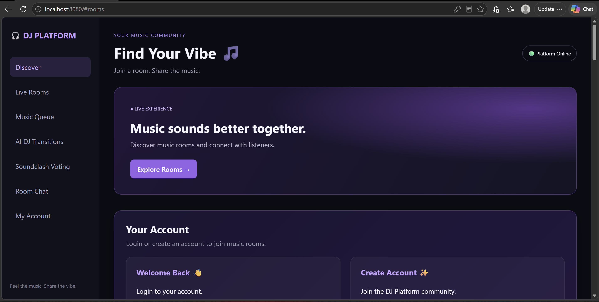
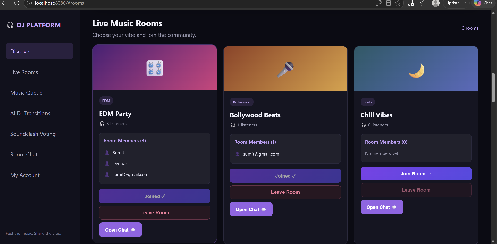
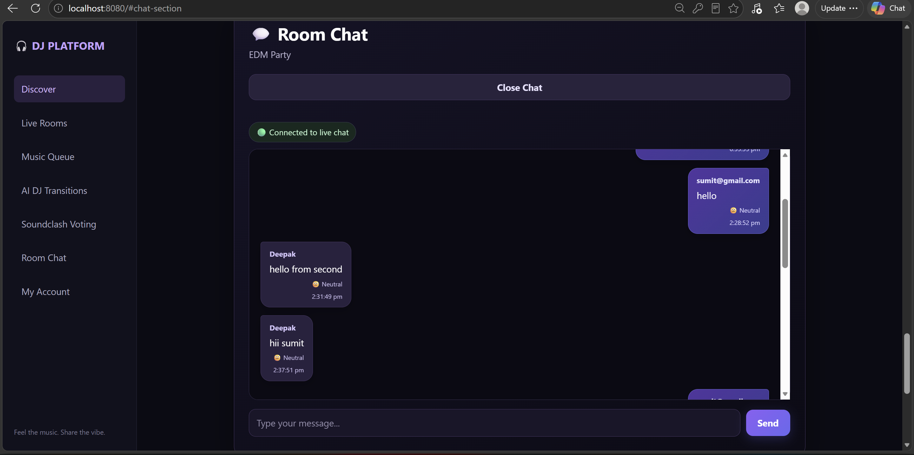
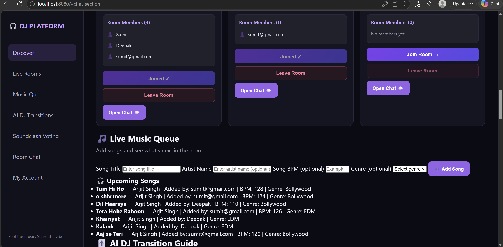
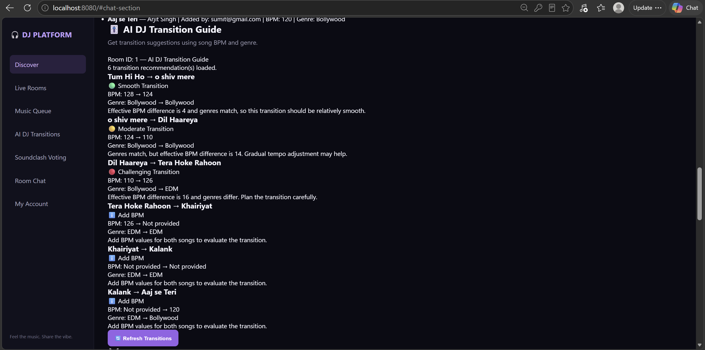
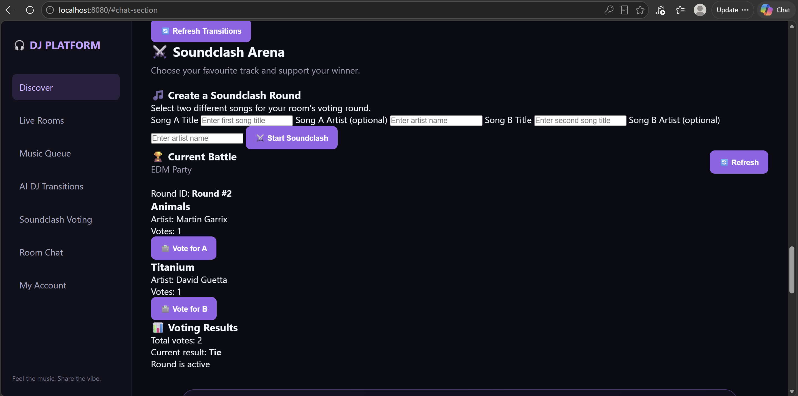
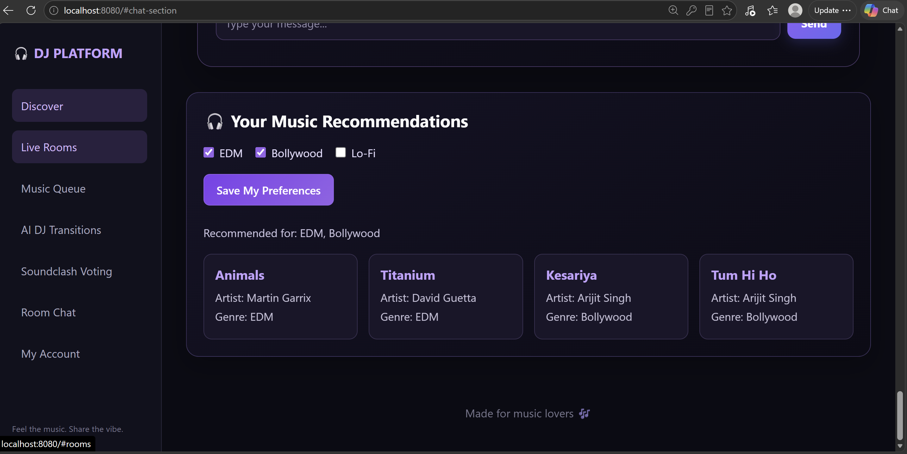

# 🎧 DJ Platform

An AI-powered collaborative music platform built using Java, Spring Boot, MySQL, HTML, CSS, and JavaScript.

## Features

- User registration and login
- Database-backed music rooms
- Room membership management
- Authenticated room-based chat

## Technology Stack

- Java 21
- Spring Boot
- Spring Data JPA
- Spring Security
- MySQL
- HTML, CSS, JavaScript
- Maven

## 📸 Project Screenshots

## 1. Dashboard


## 2. Room Membership


## 3. Real-Time Chat


## 4. Music Queue


## 5. AI DJ Transitions


## 6. Soundclash Voting


## 7. Music Recommendations



## Getting Started

## Prerequisites

- Java JDK 21
- MySQL Server
- Git

## Clone the Repository


git clone https://github.com/Sumit-Prakash-Verma/dj-platform.git
cd dj-platform


## Database Setup

Create the database in MySQL:

```sql
CREATE DATABASE dj_platform;
```

Configure your local database credentials using the project's example configuration. Never commit passwords or other secrets.

## Run the Application

On Windows PowerShell, from the project root, run:

powershell
.\mvnw.cmd spring-boot:run


Open http://localhost:8080 in your browser.

## Author

Sumit Prakash Verma

GitHub: https://github.com/Sumit-Prakash-Verma
